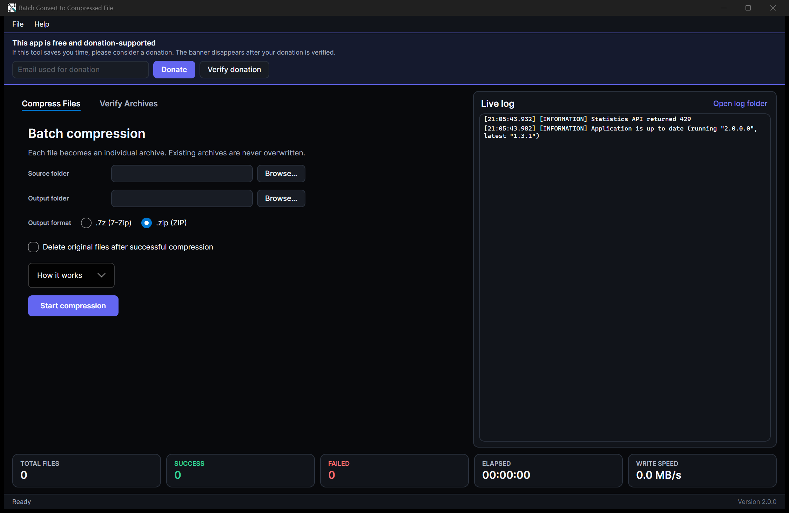

# Batch Convert to Compressed File

A cross-platform desktop utility for **batch compressing files** into individual `.7z` or `.zip`
archives and **verifying the integrity** of existing `.7z`, `.zip`, and `.rar` archives.

Built with **Avalonia 12**, **.NET 10**, and **SharpCompress**. Runs on Windows, Linux, and macOS
on both **x64** and **arm64**.



## Features

- **Batch compression** - one archive per file, `.7z` (LZMA2) or `.zip` (Deflate)
- **Archive verification** - `.7z`, `.zip`, and `.rar`, with full size and CRC-32 checks
- **Flexible file management** - optionally delete originals after compression, or move verified
  and failed archives into separate folders while preserving subfolders
- **Live feedback** - progress bar, current file, elapsed time, write speed, and success/failure
  statistics
- **Live log on the right** - resizable activity log powered by Serilog
- **Professional black/indigo theme** - tooltips on every control
- **About window** - version, platform, runtime, and project links
- **GitHub update check** - offers to open the download page when a newer release exists
- **Donation banner** - disappears permanently only after a donation is verified by the API
- **Startup statistics** - anonymous application ID and version sent to the stats endpoint
- **Automatic bug reports** - every Warning+ Serilog event is forwarded to the bug report API
- **Fully managed archive engine** - no native 7-Zip binaries on any platform

## Downloads

Pick the asset for your platform from the
[latest release](https://github.com/purelogiccode/BatchConvertToCompressedFile/releases/latest):

| Platform | x64 | arm64 |
| --- | --- | --- |
| Windows | `..._win-x64.zip` | `..._win-arm64.zip` |
| Linux | `..._linux-x64.tar.gz` | `..._linux-arm64.tar.gz` |
| macOS | `..._osx-x64.tar.gz` | `..._osx-arm64.tar.gz` |

Each release also publishes `checksums.txt` with SHA-256 hashes.

## Requirements

- **Releases:** self-contained; no .NET installation required
- **From source:** .NET 10 SDK
- **Linux/macOS:** a graphical desktop session (X11, Wayland, or Aqua)

## Usage

### Compress files

1. Open the **Compress Files** tab.
2. Select a source folder and an output folder (they must be different).
3. Choose `.7z` or `.zip`.
4. Optionally enable deletion of originals after successful compression.
5. Click **Start compression**.

Existing archives are skipped and never overwritten.

### Verify archives

1. Open the **Verify Archives** tab.
2. Select the archives folder.
3. Optionally enable subfolder scanning and success/failed move folders.
4. Click **Start verification**.

Every entry is fully decompressed and checked against its stored size and CRC-32.

## Build and test

```powershell
dotnet restore CSharp_BatchConvertToCompressedFile.sln
dotnet build   CSharp_BatchConvertToCompressedFile.sln -c Release
dotnet test    CSharp_BatchConvertToCompressedFile.sln -c Release
```

Run:

```powershell
dotnet run --project BatchConvertToCompressedFile
```

Publish for any RID:

```powershell
dotnet publish BatchConvertToCompressedFile -c Release -r linux-arm64 --self-contained true `
  -p:PublishSingleFile=true -p:IncludeNativeLibrariesForSelfExtract=true -o artifacts/linux-arm64
```

Supported RIDs: `win-x64`, `win-arm64`, `linux-x64`, `linux-arm64`, `osx-x64`, `osx-arm64`.

## Documentation

Full documentation lives in [`docs/`](docs/index.md):

- [Getting started](docs/getting-started.md)
- [User guide](docs/user-guide.md)
- [Configuration](docs/configuration.md)
- [Logging and bug reports](docs/logging-and-bug-reports.md)
- [Donation](docs/donation.md)
- [Statistics](docs/statistics.md)
- [Architecture](docs/architecture.md)
- [Building and testing](docs/building-and-testing.md)
- [CI/CD](docs/ci-cd.md)
- [Release process](docs/release-process.md)
- [Security](docs/security.md)
- [Manual testing](docs/manual-testing.md)
- [Validation report](docs/validation-report.md)
- [Troubleshooting](docs/troubleshooting.md)

## CI/CD

- Build + tests on Windows, Linux, and macOS
- Cross-publish validation for all six RIDs
- Tag-driven releases with ZIP/TAR.GZ packages and SHA-256 checksums
- CodeQL, Dependency Review, Dependabot, and NuGet audit
- MkDocs Material documentation deployed to GitHub Pages

## Security

Please report vulnerabilities privately through
[GitHub Security Advisories](https://github.com/purelogiccode/BatchConvertToCompressedFile/security/advisories/new).
See [`SECURITY.md`](SECURITY.md) for the full policy.

## Support this project

If this tool saves you time, please consider a donation:

**[Donate](https://www.purelogiccode.com/Donate?app=batch-convert-to-compressed-file)**

Every donation helps keep the application free and actively maintained.

## Acknowledgements

- Uses [SharpCompress](https://github.com/adamhathcock/sharpcompress) for managed archive handling.
- Built with [Avalonia](https://avaloniaui.net/) and [Serilog](https://serilog.net/).
- Developed by [Pure Logic Code](https://www.purelogiccode.com).

---

Thank you for using **Batch Convert to Compressed File**!
